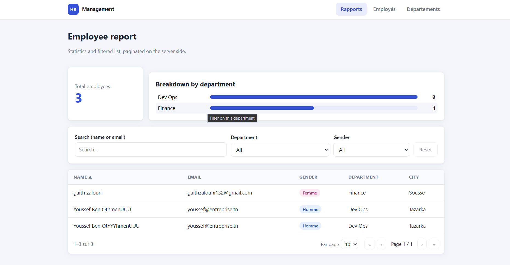
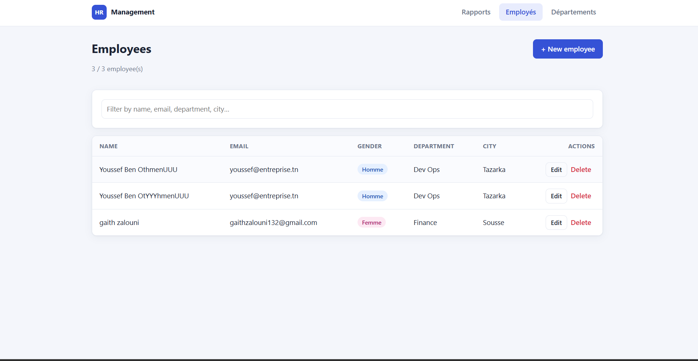

# Employee Management System — Backend API

A Human Resources Management REST API built with **Spring Boot 3**, **Java 17**, and **PostgreSQL**, featuring an analytical reporting module with multi-criteria search and pagination, along with full container orchestration via **Docker Compose**.

---

## Architecture & Features

- **Department Management (`/api/department`)**: Create, retrieve, update, and delete departments using `UUID` identifiers.
- **Employee & Address Management (`/api/employee`)**:
  - Full CRUD operations for employees (`UUID`, name, email, gender `Male`/`Female`).
  - `@ManyToOne` relationship linking employees to departments.
  - Automated address lifecycle management (`@OneToOne` with `CascadeType.ALL` and `orphanRemoval = true`) handled seamlessly during employee creation, updates, and deletion.
- **Reports & Paginated Search (`/api/reports`)**:
  - Global metrics: total company headcount and employee breakdown by department.
  - Combined database-level filtering: case-insensitive text search (`keyword` across name and email), filtering by `departementId`, and filtering by `gender`.
  - Dynamic pagination and sorting powered by `Spring Data Pageable` (`page`, `size`, `sort`).
- **Software Craftsmanship & Architecture**:
  - Strict layered separation (`Controller` → `Service` → `Repository`).
  - **DTO Pattern** (`RequestDto` / `ResponseDto`) decoupling JPA entities from external API contracts.
  - Constructor-based dependency injection (`private final` + `@RequiredArgsConstructor`).
  - Dedicated **CORS** configuration for seamless frontend integration (Angular running on `http://localhost:4200`).

---

## Application Preview

### Dashboard & Analytical Reports


### Employee Management & Pagination


### Employee & Nested Address Form


---

## Tech Stack

- **Language & Framework:** Java 17, Spring Boot 3.3.4
- **Persistence:** Spring Data JPA / Hibernate 6, PostgreSQL 16
- **Build & Productivity:** Lombok, Maven
- **Containerization:** Docker (Multi-stage build), Docker Compose

---

## Quick Start with Docker (Recommended)

Ensure **Docker Desktop** is running, then execute the following command at the root of the project:

```bash
docker compose up --build -d